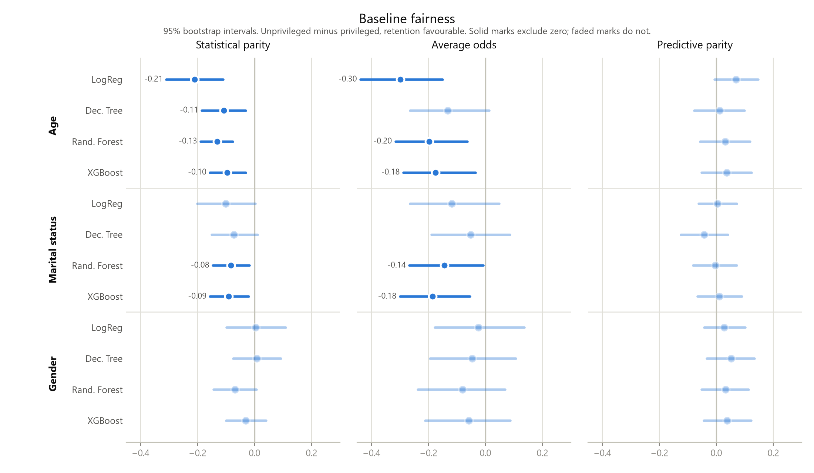
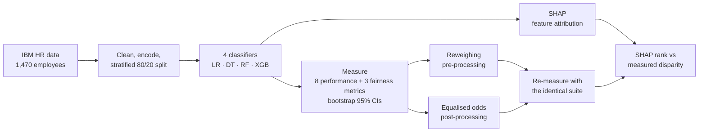
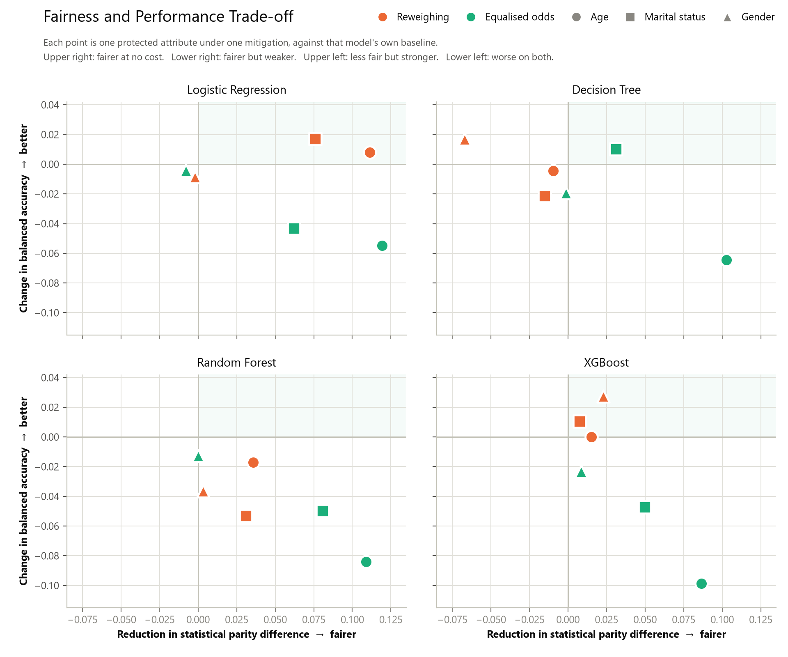
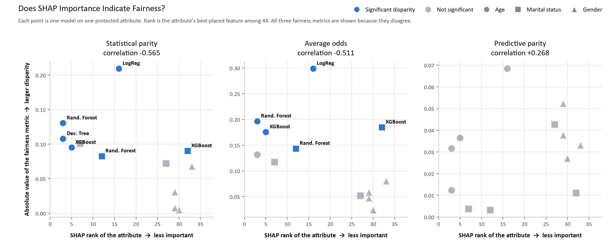

# Fairness Audit of Employee Attrition Models

**Do HR attrition models treat employees evenly, and what does it cost to fix them when they don't?**

This project trains four attrition classifiers on the IBM HR Analytics dataset. It audits them for bias across age, gender and marital status, tests two bias-mitigation strategies, and checks whether SHAP explainability can show where unfair treatment sits.

`Python` · `scikit-learn` · `XGBoost` · `AI Fairness 360` · `SHAP` · `pandas` · `Matplotlib` · `Jupyter`

---

## Key findings

- **Bias was measurable, and it always ran against the less advantaged group.** 11 of 36 fairness checks showed a statistically significant disparity. They were concentrated on **age** and appeared in **all four models**.
- **Simpler models were no fairer.** The widest gap, about **21 percentage points** in statistical parity, came from Logistic Regression, the strongest model on recall and PR-AUC.
- **Every fairness gain had a predictive cost.** Reweighing closed **6 of 11** disparities for a 0.005 drop in balanced accuracy. Equalised odds closed **all 11** for 0.041, which is about 3× the fairness gain for about 8× the cost.
- **SHAP importance did not show where the unfairness was.** The correlation between a protected attribute's SHAP rank and its measured disparity ranged from **−0.565 to +0.268**, depending on the fairness metric. Bias travelled through correlated proxies such as job level, income and tenure.



<sub>Each bar is a 95% bootstrap confidence interval for unprivileged minus privileged, with retention as the favourable outcome. Solid marks are disparities whose interval excludes zero.</sub>

---

## Why it matters

Attrition models are usually judged on accuracy alone. A model trained on historical HR records can reproduce the patterns in those records. Under the UK Equality Act 2010, that is a legal exposure as well as an ethical one. This project treats fairness as something to measure, with uncertainty, before a model is trusted.

## Questions

1. Do trained attrition models produce measurable disparities across age, gender and marital status?
2. How do pre-processing and post-processing mitigation compare at closing those disparities, and what do they cost in predictive performance?
3. Does SHAP-based explainability show where unfair treatment sits?

## Approach



| Stage | What was done |
|---|---|
| **Data** | 1,470 records with a 16% attrition rate. Constant and identifier columns removed, 23 numeric features standardised and 7 categorical features one-hot encoded, giving 44 features. The preprocessor was fitted on training data only. |
| **Models** | Logistic Regression, Decision Tree, Random Forest and XGBoost, chosen to span an interpretability gradient. Class weighting offsets the 5.2 : 1 imbalance, with a fixed seed throughout. |
| **Fairness** | Statistical Parity, Average Odds and Predictive Parity Differences, for each model and each protected attribute (36 checks). A disparity counts only when its bootstrap CI (1,000 resamples) excludes zero. |
| **Mitigation** | AIF360 **Reweighing** (instance weights before training) and **Equalised Odds post-processing** (group-specific thresholds after training), run per attribute: 24 mitigation runs. |
| **Explainability** | Mean absolute SHAP values per model, then compared with each attribute's measured disparity. |

All three rounds (baseline, reweighing, equalised odds) are scored by one shared measurement module, [`src/metrics.py`](src/metrics.py). That keeps the comparisons like-for-like.

The full method is in **[docs/methodology.md](docs/methodology.md)**.

---

## Results

### Baseline performance

Ten-fold stratified cross-validation on the training set:

| Model | Balanced acc. | Recall | ROC-AUC | PR-AUC | Brier ↓ |
|---|---|---|---|---|---|
| Logistic Regression | **0.745** | **0.742** | **0.830** | **0.618** | 0.158 |
| Decision Tree | 0.571 | 0.279 | 0.571 | 0.204 | 0.231 |
| Random Forest | 0.658 | 0.353 | 0.799 | 0.544 | 0.117 |
| XGBoost | 0.694 | 0.437 | 0.804 | 0.566 | **0.110** |

Accuracy is misleading on this data. Decision Tree scores 0.769 accuracy, ahead of Logistic Regression's 0.747, while catching far fewer leavers. Reporting therefore leads with balanced accuracy, recall and PR-AUC.

### The fairness and performance trade-off



| Strategy | Disparities closed | Change in balanced accuracy |
|---|---|---|
| Reweighing (pre-processing) | 6 of 11 | −0.005 |
| Equalised odds (post-processing) | 11 of 11 | −0.041 |

Equalised odds is the stronger fix but the more expensive one. One caveat: one model met the equalised-odds criterion only by flagging **229 of 294** test employees as likely to leave. That is compliant on paper and useless in practice.

### Does SHAP show where the bias is?



No, at least not reliably. Whether attributes the model leans on more look less fair, more fair or unrelated depends on which fairness metric you pick. Most of the apparent signal comes from gender, the one attribute with no disparity at all. A model can treat groups unevenly while giving the protected characteristic itself little direct attribution.

<details>
<summary><b>More figures</b></summary>

| Figure | File |
|---|---|
| Fairness after reweighing | [02_reweighing_fairness.png](results/figures/02_reweighing_fairness.png) |
| Fairness after equalised odds | [03_equalised_odds_fairness.png](results/figures/03_equalised_odds_fairness.png) |
| Top SHAP features, all models | [05_shap_importance_all_models.png](results/figures/05_shap_importance_all_models.png) |
| Top SHAP features, transparent models | [06_shap_importance_transparent.png](results/figures/06_shap_importance_transparent.png) |
| Top SHAP features, ensemble models | [07_shap_importance_ensemble.png](results/figures/07_shap_importance_ensemble.png) |
| SHAP rank vs statistical parity | [08_shap_vs_fairness_spd.png](results/figures/08_shap_vs_fairness_spd.png) |

</details>

---

## What this means in practice

1. **Audit fairness before deployment.** The disparities here were invisible in standard accuracy reporting.
2. **Report the three fairness metrics together.** They disagree, and any one of them alone can mislead.
3. **State every fairness improvement alongside its predictive cost.** "Fairer" is only half of a claim.
4. **Do not treat feature importance as a fairness audit.** Bias can travel through proxies that explainability tools attribute elsewhere.

---

## Repository structure

```
employee-attrition-prediction/
├── data/
│   ├── raw/                 # IBM HR Analytics dataset (source CSV)
│   ├── processed/           # cleaned data and train/test splits (generated, git-ignored)
│   └── README.md            # dataset source, columns and preparation notes
├── notebooks/
│   ├── 01_data_preparation.ipynb   # audit, cleaning, protected groups, encoding, split
│   └── 02_model_building.ipynb     # 4 classifiers, cross-validation, baseline measurement
├── src/
│   └── metrics.py           # shared performance + fairness suite with bootstrap CIs
├── results/
│   ├── figures/             # all charts shown in this README
│   ├── tables/              # metric tables (generated)
│   ├── models/              # fitted models (generated, git-ignored)
│   └── predictions_baseline.csv
├── docs/
│   └── methodology.md       # full method, metric definitions and limitations
├── .devcontainer/           # reproducible Python 3.13 environment
└── requirements.txt         # pinned dependency versions
```

## Running it

Requires **Python 3.13**. Versions are pinned because AI Fairness 360 0.6.1 is sensitive to its surrounding stack.

```bash
git clone https://github.com/aoiyiola/employee-attrition-prediction.git
cd employee-attrition-prediction
python -m venv .venv
source .venv/bin/activate        # Windows: .venv\Scripts\activate
pip install -r requirements.txt
```

Then run the notebooks in order: `01_data_preparation` writes the train/test split that every later notebook reads. The notebooks work whether Jupyter is started from the repository root or from `notebooks/`.

Alternatively, open the repository in VS Code or GitHub Codespaces and choose **Reopen in Container**. The dev container installs everything.

## Project status

Data preparation and baseline modelling are in the notebooks here. The reweighing, equalised-odds and SHAP notebooks that produced figures 02–09 are being added. Until then, those results are shown as figures.

---

## About

Built by **Afees Iyiola** as the research project for the MSc in Applied Artificial Intelligence and Data Analytics at the University of Bradford (2025/26).

**Data:** [IBM HR Analytics Employee Attrition & Performance](https://www.kaggle.com/datasets/pavansubhasht/ibm-hr-analytics-attrition-dataset), a fictional dataset created by IBM data scientists for analytics research.
